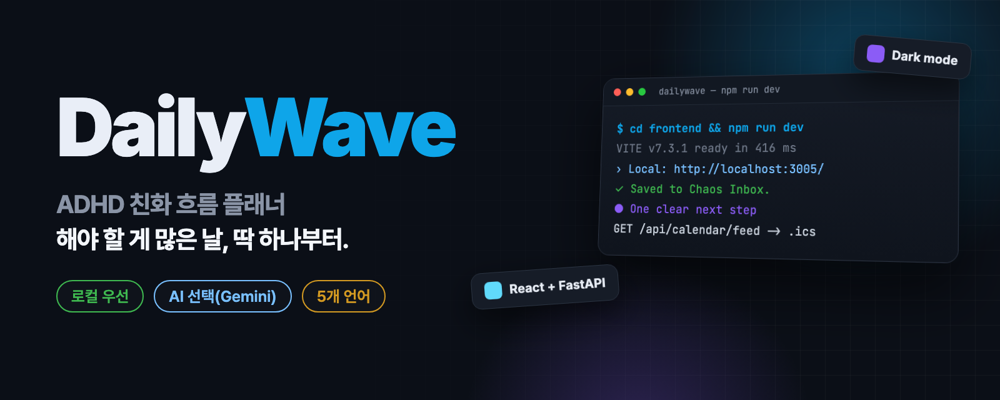
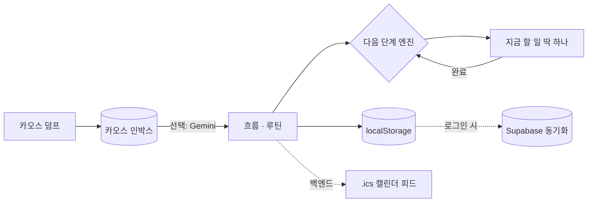

<p align="center">
  
</p>

<p align="center">
  <a href="README.md"><b>English</b></a> · <b>한국어</b>
</p>

<h2 align="center">할 일이 너무 많을 때,<br>DailyWave는 지금 할 일 딱 하나를 보여 줍니다. 그다음도 하나씩.</h2>

<p align="center">
  복잡한 할 일 목록을 차분한 단계별 흐름으로 바꿔 주는 ADHD 친화 플래너입니다.<br>
  계정 없이 바로 쓸 수 있고, Gemini AI 도움은 선택입니다.
</p>

<p align="center">
  <a href="https://dailywave.vercel.app"></a>
  <a href="LICENSE"></a>
  <a href="https://github.com/kks0488/dailywave/actions/workflows/ci.yml"></a>
  
  
  <a href="https://github.com/kks0488/dailywave/stargazers"></a>
</p>

<table>
<tr>
<td width="50%" valign="top">

### 지금 할 일 딱 하나
홈 화면이 지금 바로 시작할 수 있는 일 하나(흐름의 진행 중 단계나 다음 루틴)만 골라 보여 주고 나머지는 숨깁니다.

</td>
<td width="50%" valign="top">

### 카오스 덤프
머릿속 생각을 전부 적어 카오스 인박스에 저장하면 잊어버리지 않습니다. AI를 연결하면 흐름과 루틴으로 정리해 줍니다.

</td>
</tr>
<tr>
<td width="50%" valign="top">

### 흐름과 루틴을 한 화면에
프로젝트는 한 단계씩 열리는 흐름이 됩니다. 오전·오후 루틴이 그 옆에 함께 보입니다.

</td>
<td width="50%" valign="top">

### 작은 성공도 성공
Victory Wall이 오늘 시도하고 끝낸 일을 보여 주고, 자책 없는 요약과 내일 첫 단계를 제안합니다.

</td>
</tr>
</table>

## 바로 써 보기

라이브 앱: **[dailywave.vercel.app](https://dailywave.vercel.app)** — 가입 없이 쓸 수 있고, 게스트 데이터는 브라우저에 남습니다.

1. **카오스 덤프**에 전부 적고 **인박스에 저장**을 누릅니다.
2. **+** 로 흐름을 추가하거나, 사이드바에서 루틴을 추가합니다.
3. **지금 할 일 딱 하나**를 따라갑니다. 끝내면 다음 단계가 열립니다.

선택: **설정**에서 Gemini API 키를 넣으면 AI 제안을 받을 수 있고, Google 로그인으로 여러 기기에서 동기화할 수 있습니다.

## 내 PC에서 실행

프런트엔드만(앱을 쓰기에 충분):

```bash
git clone https://github.com/kks0488/dailywave.git
cd dailywave/frontend
npm install
npm run dev        # http://localhost:3005
```

Docker로 전체 실행(프런트엔드, FastAPI 백엔드, memU 서버):

```bash
cp backend/.env.example backend/.env
docker-compose up -d
# 웹 화면  http://localhost:3020
# API 문서 http://localhost:8020/docs
```

## 화면

<p align="center">
  
</p>
<p align="center">
  
</p>
<p align="center"><sub>예시 할 일을 넣어 로컬에서 실행한 화면입니다(실제 사용자 데이터 아님).</sub></p>

## 동작 방식



흐름은 순서가 있는 단계 목록이고, 진행 중 단계를 끝내면 다음 단계가 열립니다. 데이터는 브라우저에 자동 저장됩니다. 선택 사항인 FastAPI 백엔드는 속도 제한이 있는 서버 측 Gemini 프록시, JSON 저장, `.ics` 캘린더 피드, memU 메모리를 더합니다.

## 자주 묻는 질문

**계정이 필요한가요?**
아니요. 게스트 모드는 모든 것을 브라우저에 저장합니다. 클라우드 동기화가 필요할 때만 로그인하세요.

**AI가 꼭 필요한가요?**
아니요. 다음 단계 고르기, 카오스 인박스, 루틴, Victory Wall은 AI 없이 동작합니다. Gemini를 연결하면 추천과 자동 정리가 추가됩니다.

**어떤 언어를 지원하나요?**
영어, 한국어, 일본어, 중국어, 독일어를 지원하고 다크 모드도 있습니다.

## 로드맵

계획 단계이며 아직 만들지 않았습니다([`docs/ROADMAP.md`](docs/ROADMAP.md) 기준):

- 네이티브 모바일 앱(`mobile/`에 Flutter 뼈대, `ios-swift/`에 SwiftUI 시제품이 있음)
- 복잡한 흐름을 위한 DAG 실행기
- Playwright 종단 간 테스트

<details>
<summary><b>기술 상세</b></summary>

### 추가 기능

- **심플 모드**(기본): 버튼을 줄이고 카오스 덤프 중심으로 보여 줌.
- **"What's Next?" AI**(Gemini, 선택): 에너지 수준을 고려한 추천과 AI 명령 입력(예: "오전 9시에 운동 루틴 추가").
- **Flow Recipes**: 흐름을 재사용 가능한 템플릿으로 저장.
- 흐름·단계 **드래그 앤 드롭**, `Cmd/Ctrl+Z`·`Cmd/Ctrl+Shift+Z` **되돌리기/다시 실행**, `Cmd/Ctrl+?` 단축키 목록.
- **캘린더 피드**: 캘린더 앱에서 `/api/calendar/feed`(`.ics`) 구독.
- **memU 연동**(선택): 과거 행동 기반의 개인화된 AI 맥락.
- **로그인**: 기본은 Google. `VITE_AUTH_PROVIDERS`로 Apple·GitHub를 켤 수 있음.

### 기술 스택

| 부분 | 기술 |
| --- | --- |
| 프런트엔드 | React 18, Vite 7, Zustand, i18next, Lucide 아이콘 |
| 백엔드 | FastAPI, Pydantic, iCalendar, httpx |
| 서비스(선택) | Supabase(로그인·동기화), memU(AI 메모리), Redis(속도 제한) |
| 테스트 | Vitest(프런트엔드), pytest(백엔드), GitHub Actions CI |
| 배포 | Vercel(프런트엔드), Docker 또는 PM2 |

### 로컬 개발(백엔드)

```bash
cd backend
python -m venv venv
source venv/bin/activate   # Windows: venv\Scripts\activate
pip install -r requirements.txt
cp .env.example .env
uvicorn main:app --host 0.0.0.0 --port 8020 --reload
```

프런트엔드 설정은 `frontend/.env.example`(`VITE_API_URL`, Supabase 키, `VITE_GEMINI_API_KEY`, `VITE_AUTH_PROVIDERS`)에 있습니다. 백엔드는 Gemini 키를 서버에만 두고(`GEMINI_API_KEY`), AI 호출에 Supabase 토큰을 요구하도록 설정할 수 있습니다.

### 운영(PM2)

```bash
npm install pm2 -g
pm2 start ecosystem.config.js
```

### API 개요

| 엔드포인트 | 메서드 | 설명 |
| :--- | :---: | :--- |
| `/` | `GET` | 상태 확인·버전 |
| `/health` | `GET` | 상태 |
| `/api/persistence/load` | `GET` | 저장된 상태 불러오기 |
| `/api/persistence/save` | `POST` | 앱 상태 저장 |
| `/api/calendar/feed` | `GET` | `.ics` 캘린더 피드 |
| `/execute` | `POST` | 워크플로 실행 |
| `/api/ai/status` | `GET` | 서버 측 AI 사용 가능 여부 |
| `/api/ai/ask` | `POST` | AI 프록시(Gemini + memU 맥락) |
| `/api/memory/track` | `POST` | memU용 행동 기록 |
| `/api/auth/account` | `DELETE` | 로그인한 계정 삭제 |

전체 문서: [`docs/API.md`](docs/API.md)

### 프로젝트 구조

```text
dailywave/
├── frontend/             # React + Vite 앱
│   └── src/
│       ├── components/   # 화면(커맨드 센터, What's Next, 카오스 인박스, 로그인…)
│       ├── store/        # Zustand 스토어
│       ├── hooks/        # 저장 동기화, AI 사용 가능 여부
│       ├── lib/          # Gemini 클라이언트, Supabase 동기화, 프롬프트, 파서
│       └── locales/      # en / ko / ja / zh / de
├── backend/              # FastAPI 앱
│   ├── main.py           # 시작점
│   ├── executor.py       # 워크플로 실행(SSRF 방어)
│   ├── storage.py        # 스레드 안전 JSON 저장
│   ├── ai_proxy.py       # 서버 측 Gemini 프록시
│   ├── rate_limiter.py   # AI 속도 제한(메모리 또는 Redis)
│   ├── memory_service.py # memU 연동
│   └── calendar_gen.py   # .ics 피드
├── mobile/               # Flutter 뼈대(초기)
├── ios-swift/            # SwiftUI 시제품
├── docs/                 # 아키텍처, API, Supabase 설정, 로드맵
├── docker-compose.yml    # 프런트엔드 + 백엔드 + memU
└── ecosystem.config.js   # PM2 설정
```

### 문서

[아키텍처](docs/ARCHITECTURE.md) · [API](docs/API.md) · [Supabase 설정](docs/SUPABASE_SETUP.md) · [배포 가이드](deployment_guide.md) · [로드맵](docs/ROADMAP.md) · [변경 기록](CHANGELOG.md) · [기여 방법](CONTRIBUTING.md)

### 상표

"DailyWave" 이름과 로고는 원작자의 상표입니다. Apache-2.0에 따라 코드를 포크·수정할 수 있지만, 허락 없이 이 이름이나 브랜딩으로 파생 제품을 홍보하지 마세요.

</details>

## 라이선스

[Apache-2.0](LICENSE) © Kyoungsoo Kim
