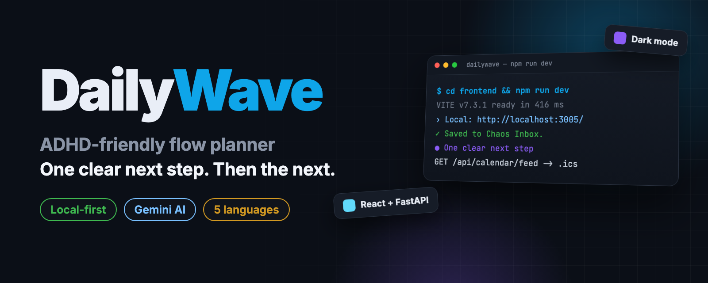
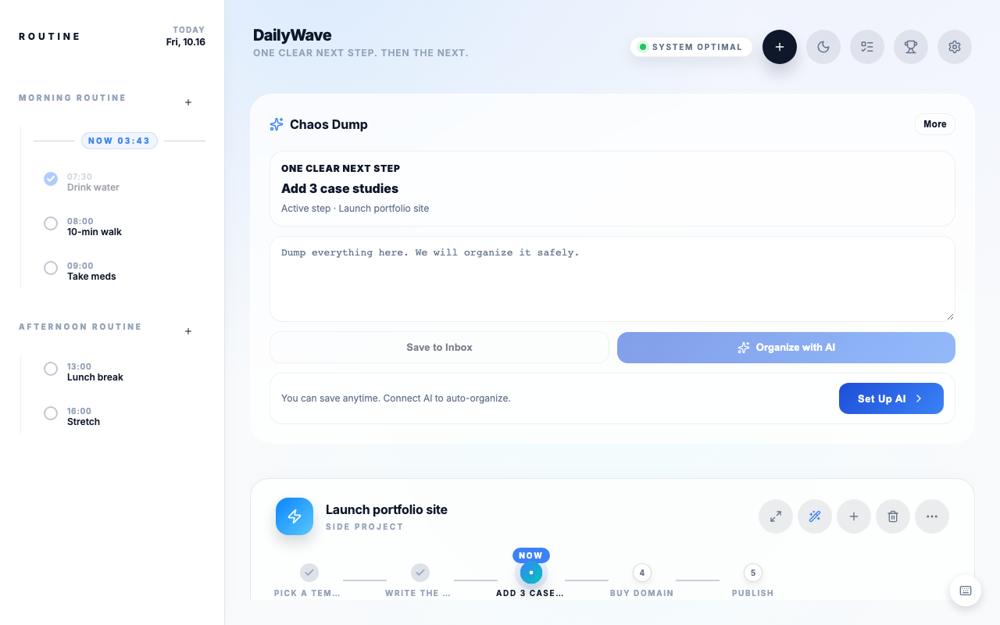
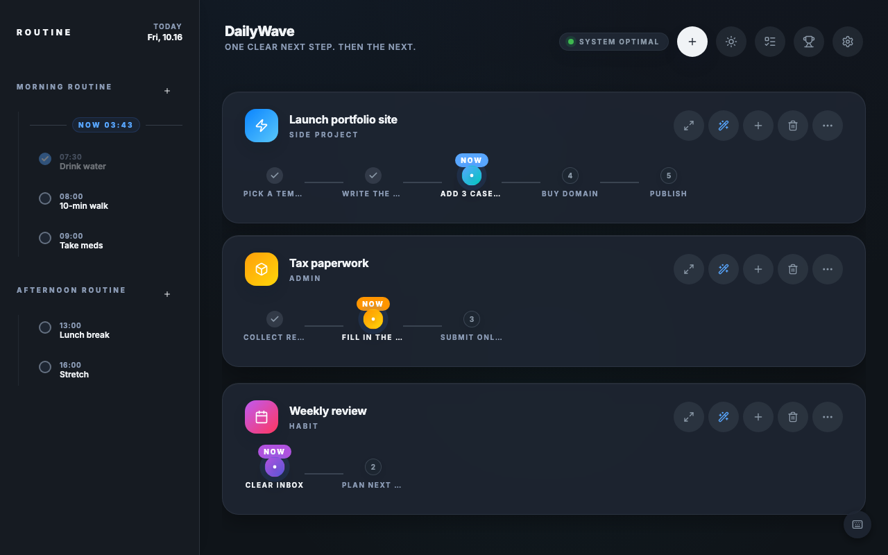
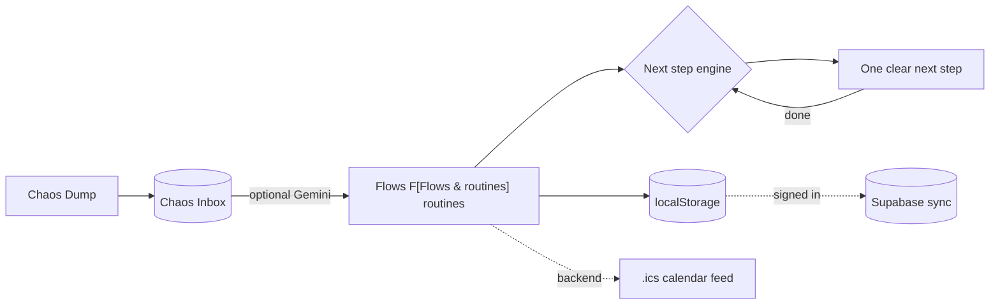

<p align="center">
  
</p>

<p align="center">
  <b>English</b> · <a href="README.ko.md"><b>한국어</b></a>
</p>

<h2 align="center">Too much to do?<br>DailyWave shows you one clear next step. Then the next.</h2>

<p align="center">
  An ADHD-friendly planner that turns a messy to-do list into calm, step-by-step flows.<br>
  Works without an account. AI help with Gemini is optional.
</p>

<p align="center">
  <a href="https://dailywave.vercel.app"></a>
  <a href="LICENSE"></a>
  <a href="https://github.com/kks0488/dailywave/actions/workflows/ci.yml"></a>
  
  
  <a href="https://github.com/kks0488/dailywave/stargazers"></a>
</p>

<table>
<tr>
<td width="50%" valign="top">

### One clear next step
The home screen picks a single task you can start now — the active step of a flow or your next routine — and hides the rest.

</td>
<td width="50%" valign="top">

### Chaos Dump
Type everything on your mind and save it to the Chaos Inbox so nothing gets lost. With AI connected, it is organized into flows and routines.

</td>
</tr>
<tr>
<td width="50%" valign="top">

### Flows and routines together
Projects become step-by-step flows that unlock one step at a time. Morning and afternoon routines sit beside them in one view.

</td>
<td width="50%" valign="top">

### Small wins count
The Victory Wall shows what you tried and finished today, with a gentle, no-shame summary and a suggested first step for tomorrow.

</td>
</tr>
</table>

## Try it

Open the live app: **[dailywave.vercel.app](https://dailywave.vercel.app)** — no sign-up needed; guest data stays in your browser.

1. Write everything in **Chaos Dump** and press **Save to Inbox**.
2. Add a flow with **+**, or a routine from the sidebar.
3. Follow **One clear next step**. Finish it, and the next step unlocks.

Optional: add a Gemini API key in **Settings** for AI suggestions, or sign in with Google to sync across devices.

## Run it locally

Frontend only (enough to use the app):

```bash
git clone https://github.com/kks0488/dailywave.git
cd dailywave/frontend
npm install
npm run dev        # http://localhost:3005
```

Full stack with Docker (frontend, FastAPI backend and a memU server):

```bash
cp backend/.env.example backend/.env
docker-compose up -d
# Web UI   http://localhost:3020
# API docs http://localhost:8020/docs
```

## Screenshots

<p align="center">
  
</p>
<p align="center">
  
</p>
<p align="center"><sub>Captured from a local run with sample tasks (no real user data).</sub></p>

## How it works



Each flow is an ordered list of steps; finishing the active step unlocks the next one. Data is saved in the browser automatically. The optional FastAPI backend adds a server-side Gemini proxy with rate limiting, JSON persistence, an `.ics` calendar feed and memU memory.

## FAQ

**Do I need an account?**
No. Guest mode stores everything in your browser. Sign in only if you want cloud sync.

**Is AI required?**
No. The next-step logic, Chaos Inbox, routines and Victory Wall work without AI. Gemini adds suggestions and auto-organizing.

**Which languages are supported?**
English, Korean, Japanese, Chinese and German, plus dark mode.

## Roadmap

Planned, not yet built (from [`docs/ROADMAP.md`](docs/ROADMAP.md)):

- Native mobile app (a Flutter shell and a SwiftUI prototype exist in `mobile/` and `ios-swift/`)
- A proper DAG executor for complex flows
- Playwright end-to-end tests

<details>
<summary><b>Technical details</b></summary>

### More features

- **Simple Mode** (default): fewer buttons, Chaos Dump-centric home.
- **"What's Next?" AI** (Gemini, optional): energy-aware recommendations and an AI command box (e.g. "Add exercise to routine at 9am").
- **Flow Recipes**: save a flow as a reusable template.
- **Drag and drop** for flows and steps; **undo/redo** with `Cmd/Ctrl+Z` and `Cmd/Ctrl+Shift+Z`; `Cmd/Ctrl+?` lists shortcuts.
- **Calendar feed**: subscribe to `/api/calendar/feed` (`.ics`) from any calendar app.
- **memU integration** (optional): personalized AI context from past behavior.
- **Auth**: Google by default. Apple and GitHub can be enabled with `VITE_AUTH_PROVIDERS`.

### Tech stack

| Part | Technology |
| --- | --- |
| Frontend | React 18, Vite 7, Zustand, i18next, Lucide icons |
| Backend | FastAPI, Pydantic, iCalendar, httpx |
| Services (optional) | Supabase (auth + sync), memU (AI memory), Redis (rate limit) |
| Tests | Vitest (frontend), pytest (backend), GitHub Actions CI |
| Deploy | Vercel (frontend), Docker or PM2 |

### Local development (backend)

```bash
cd backend
python -m venv venv
source venv/bin/activate   # Windows: venv\Scripts\activate
pip install -r requirements.txt
cp .env.example .env
uvicorn main:app --host 0.0.0.0 --port 8020 --reload
```

Frontend settings live in `frontend/.env.example` (`VITE_API_URL`, Supabase keys, `VITE_GEMINI_API_KEY`, `VITE_AUTH_PROVIDERS`). The backend keeps its Gemini key server-side (`GEMINI_API_KEY`) and can require a Supabase token for AI calls.

### Production (PM2)

```bash
npm install pm2 -g
pm2 start ecosystem.config.js
```

### API overview

| Endpoint | Method | Description |
| :--- | :---: | :--- |
| `/` | `GET` | Health check and version |
| `/health` | `GET` | Health status |
| `/api/persistence/load` | `GET` | Load saved state |
| `/api/persistence/save` | `POST` | Save app state |
| `/api/calendar/feed` | `GET` | `.ics` calendar feed |
| `/execute` | `POST` | Run a workflow pipeline |
| `/api/ai/status` | `GET` | Whether server-side AI is available |
| `/api/ai/ask` | `POST` | AI proxy (Gemini + memU context) |
| `/api/memory/track` | `POST` | Track behavior for memU |
| `/api/auth/account` | `DELETE` | Delete the signed-in account |

Full reference: [`docs/API.md`](docs/API.md).

### Project structure

```text
dailywave/
├── frontend/             # React + Vite app
│   └── src/
│       ├── components/   # UI (command center, What's Next, Chaos Inbox, auth…)
│       ├── store/        # Zustand stores
│       ├── hooks/        # Persistence sync, AI availability
│       ├── lib/          # Gemini client, Supabase sync, prompts, parsers
│       └── locales/      # en / ko / ja / zh / de
├── backend/              # FastAPI app
│   ├── main.py           # Entry point
│   ├── executor.py       # Workflow execution (SSRF-protected)
│   ├── storage.py        # Thread-safe JSON persistence
│   ├── ai_proxy.py       # Server-side Gemini proxy
│   ├── rate_limiter.py   # AI rate limiting (memory or Redis)
│   ├── memory_service.py # memU integration
│   └── calendar_gen.py   # .ics feed
├── mobile/               # Flutter shell (early)
├── ios-swift/            # SwiftUI prototype
├── docs/                 # Architecture, API, Supabase setup, roadmap
├── docker-compose.yml    # frontend + backend + memU
└── ecosystem.config.js   # PM2 config
```

### Documentation

[Architecture](docs/ARCHITECTURE.md) · [API](docs/API.md) · [Supabase setup](docs/SUPABASE_SETUP.md) · [Deployment guide](deployment_guide.md) · [Roadmap](docs/ROADMAP.md) · [Changelog](CHANGELOG.md) · [Contributing](CONTRIBUTING.md)

### Trademark

"DailyWave" and the DailyWave logo are trademarks of the original author. You may fork and modify the code under Apache-2.0, but please do not use the name or branding to promote derived products without permission.

</details>

## License

[Apache-2.0](LICENSE) © Kyoungsoo Kim
